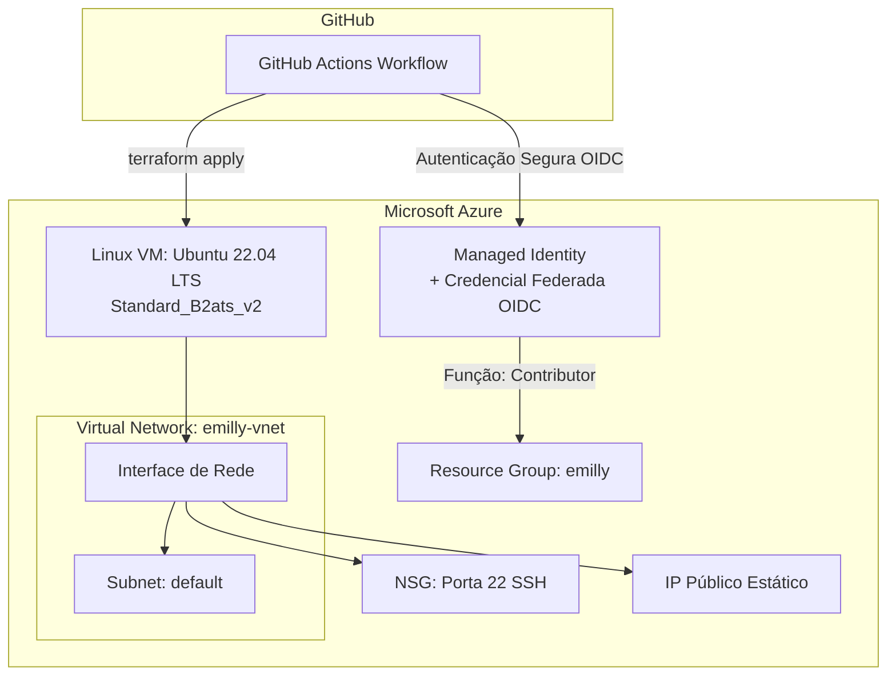

# Infraestrutura como Código (IaC) com Terraform e Azure via GitHub Actions


Repositório desenvolvido para a disciplina de **Integração e Entrega Contínua** da **Fatec Diadema - Luigi Papaiz** (Prof. Rafael Miranda).

O objetivo deste projeto é automatizar o provisionamento de infraestrutura em nuvem na **Microsoft Azure** utilizando **Terraform** e uma pipeline de CI/CD no **GitHub Actions** autenticada via **OpenID Connect (OIDC)**, eliminando o uso de senhas ou chaves estáticas (Client Secrets).

---

## 🏗️ Arquitetura da Infraestrutura

O código do Terraform ([main.tf](main.tf)) provisiona e gerencia os seguintes recursos:

* **Data Sources (Recursos preexistentes):**
  * Resource Group (`emilly`)
  * Virtual Network (`emilly-vnet`)
  * Subnet (`default`)
* **Recursos Provisionados:**
  * **Network Security Group (NSG):** Regra de firewall de entrada (Inbound) permitindo conexões SSH na porta 22.
  * **IP Público Estático:** IP público dedicado (Standard SKU) para acesso externo à VM.
  * **Interface de Rede (NIC):** Vinculada à Subnet e associada ao IP Público e ao NSG.
  * **Máquina Virtual Linux:**
    * Tamanho: `Standard_B2ats_v2`
    * Sistema Operacional: `Ubuntu Server 22.04 LTS (Jammy)` Gen2
    * Autenticação: Par de chaves SSH públicas/privadas (sem senha)
  * **Outputs:** Exibição do nome da VM, IP público atribuído e tamanho da máquina após a conclusão.



---

## 📁 Estrutura do Repositório

```text
terraform-azure/
│
├── .github/
│   └── workflows/
│       └── main.yml        # Pipeline de automação CI/CD no GitHub Actions
├── main.tf                 # Declaração dos recursos em HCL (Terraform)
└── README.md               # Documentação do projeto
```

---

## 🔐 Configuração de Segurança e Autenticação (OIDC)

A integração entre GitHub Actions e Azure utiliza federação de identidade via **OIDC**:

1. **Identidade Gerenciada (Managed Identity):** Criada no Azure Portal com a função (*role*) **Contributor** atribuída à Subscription / Resource Group.
2. **Credencial Federada:**
   * **URL do Emissor:** `https://token.actions.githubusercontent.com`
   * **Entidade:** Branch (`main`)
   * **Repositório:** `emillybudri/terraform-azure`
3. **GitHub Secrets:** Configuradas em *Settings > Secrets and variables > Actions*:
   * `AZURE_CLIENT_ID`: ID do cliente da Identidade Gerenciada.
   * `AZURE_TENANT_ID`: ID do Tenant (Diretório) do Azure.
   * `AZURE_SUBSCRIPTION_ID`: ID da Assinatura (ex.: Azure for Students).

---

## 🚀 Pipeline de CI/CD ([main.yml](.github/workflows/main.yml))

O fluxo de trabalho é disparado manualmente através do gatilho `workflow_dispatch`.

### Etapas da Execução:
1. **Baixar código (`actions/checkout@v4`):** Clona o repositório no agente Ubuntu.
2. **Autenticar no Azure (`azure/login@v2`):** Realiza a autenticação OIDC e valida com `az account show`.
3. **Instalar Terraform (`hashicorp/setup-terraform@v3`):** Prepara a CLI do Terraform.
4. **Inicializar Terraform (`terraform init`):** Baixa o provider `hashicorp/azurerm` e inicializa o backend.
5. **Planejar Terraform (`terraform plan`):** Gera o plano de execução e valida a sintaxe dos recursos.
6. **Aplicar Terraform (`terraform apply -auto-approve`):** Cria/atualiza os recursos no Azure de forma automatizada.

---

## 💻 Como Executar

### 1. Via GitHub Actions (Recomendado)
1. Acesse a aba **Actions** no repositório do GitHub.
2. No menu lateral, selecione a workflow **Terraform Azure**.
3. Clique em **Run workflow**, selecione a branch `main` e confirme.
4. Acompanhe a execução dos jobs e logs em tempo real.

### 2. Acessando a Máquina Virtual Provisionada
Após o término do apply com sucesso, consulte o IP público exibido no output do Terraform ou no Portal do Azure e conecte-se via SSH:

```bash
ssh -i /caminho/para/sua/chave_privada emilly@<IP_PUBLICO>
```

---

## 👩‍💻 Autora

* **Emilly Budri Bognar**
* Matéria: Integração e entrega contínua - DSM
* Fatec Diadema - Luigi Papaiz
